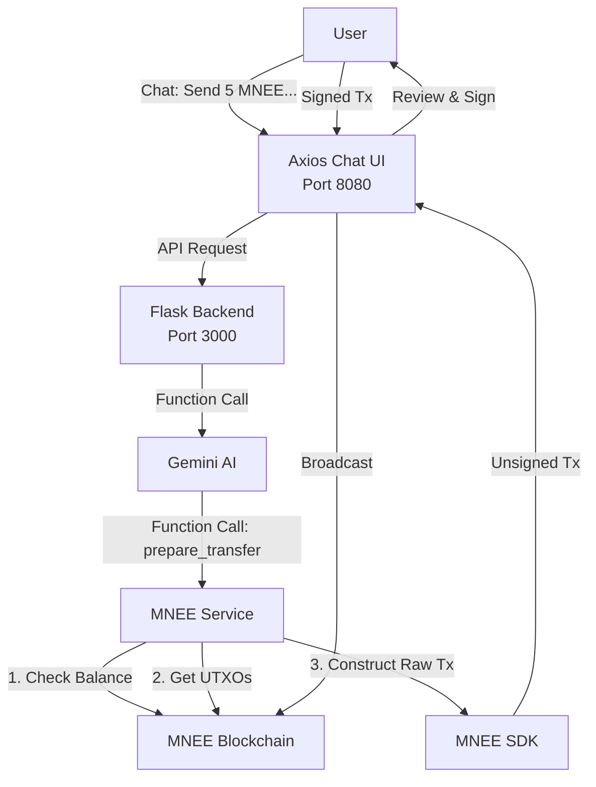

# 🤖 AxiosChat: The First Agentic Wallet on MNEE

> **"Don't just chat about crypto. Use an AI agent that can actually pay."**

  

AxiosChat transforms the crypto experience by integrating a **native MNEE wallet directly into the AI Agent's persona**. It bridges the gap between natural language and blockchain execution, enabling "Agentic Commerce" where AI doesn't just assist—it transacts.

---

## 🚀 The Vision: Why This Matters

Current crypto tools force users to context-switch: copy addresses, open wallet apps, sign, switch back. **AxiosChat eliminates this friction.**

- **🗣️ Natural Language Payments:** "Send 5 MNEE to @Alice for coffee." → **Done.**
- **🧠 Autonomous Management:** Your agent monitors your balance and alerts you to low funds.
- **💡 Smart Context:** "Tip the author of this article." → Agent resolves the address and prepares the tx.

**This is not just a chatbot. It's an autonomous financial agent.**

---

## ✨ Key Capabilities

| Feature | Description | MNEE Tech Used |
| :--- | :--- | :--- |
| **Text-to-Pay** | Execute transfers using conversational English. No more hex addresses. | `mnee.transfer`, `mnee.transferMulti` |
| **Agent Wallet** | A dedicated HD sub-account derived specifically for the agent. | `Mnee.HDWallet`, `deriveAddress` |
| **Smart Tipping** | Instantly tip creators or service providers based on context. | `mnee.getUtxos`, `validateMneeTx` |
| **Balance Watch** | Proactive monitoring of your financial state. | `mnee.balance` |

---

## 🛠️ Technical Architecture

AxiosChat is built for speed and security, leveraging the full power of the **MNEE SDK** and **Google Gemini**. The architecture consists of a React frontend and a Flask backend that work together to enable seamless AI-powered transactions.



**Architecture Components:**
- **Frontend (React + Vite)**: User interface, transaction signing, wallet management
- **Backend (Flask)**: Gemini function calling proxy, API routing, error handling
- **MNEE SDK**: Blockchain interactions, UTXO management, transaction construction
- **Gemini AI**: Natural language understanding, function calling, intent recognition

---

## 🏁 Developer Quickstart

Ready to build the future of payments? Follow these steps to get AxiosChat running locally.

### 1. Prerequisites

- **Node.js** v18+ & `pnpm`
- **Python** 3.8+ & `pip`
- **MNEE CLI**: `npm i -g @mnee/cli`
- **MNEE Developer Account**: [developer.mnee.net](https://developer.mnee.net/)
- **Gemini API Key**: [Google AI Studio](https://makersuite.google.com/app/apikey)

### 2. Wallet Setup (Sandbox)

Create a secure environment for testing:

```bash
# Create a new MNEE sandbox wallet
mnee create --network sandbox

# Fund it (Free tokens!)
mnee faucet --address <YOUR_NEW_ADDRESS>

# Export your WIF key (Save this!)
mnee export
```

### 3. Installation

```bash
git clone https://github.com/your-username/axioschat-sensay.git
cd axioschat-sensay

# Install frontend dependencies
pnpm install

# Install backend dependencies
python3 -m venv venv
source venv/bin/activate  # On Windows: venv\Scripts\activate
pip install -r requirements.txt
```

### 4. Backend Setup

The backend Flask server provides API endpoints for Gemini function calling and Replicate integration. Start it in a separate terminal:

```bash
# Activate virtual environment (if not already active)
source venv/bin/activate  # On Windows: venv\Scripts\activate

# Run the Flask backend server
./venv/bin/python api/replicate_py.py
```

The backend will start on `http://localhost:3000` and provide these endpoints:
- `/api/gemini_functions` - Gemini function calling proxy
- `/api/replicate` - Replicate API proxy (legacy)
- `/api/gemini_health` - Health check endpoint

> **Note:** Keep this terminal running while using AxiosChat. The frontend depends on these API endpoints.

### 5. Configuration

Create a `.env` file in the root directory:

```env
# AI Configuration (Frontend)
VITE_GEMINI_API_KEY=your_gemini_api_key_here

# AI Configuration (Backend - Flask)
GEMINI_API_KEY=your_gemini_api_key_here
# Alternative: GOOGLE_API_KEY=your_gemini_api_key_here

# MNEE Blockchain Configuration
VITE_MNEE_NETWORK=sandbox
VITE_MNEE_API_KEY=your_mnee_api_key
# Your Sandbox WIF Key (From Step 2)
MNEE_WIF_KEY=your_wif_key_here 

# Backend Server Configuration (Optional)
PORT=3000  # Default Flask port
```

**Get your credentials:**
- `GEMINI_API_KEY`: Get from [Google AI Studio](https://makersuite.google.com/app/apikey) (use same key for both `VITE_GEMINI_API_KEY` and `GEMINI_API_KEY`)
- `MNEE_API_KEY`: Get from [MNEE Developer Portal](https://developer.mnee.net/) (Default Sandbox Key: `288d25c25b60dc771ccb7ca8dcffc7d7`)
- `MNEE_WIF_KEY` & `MNEE_ADDRESS`: Run `mnee export` after creating your wallet

### 6. Launch 🚀

**Terminal 1 - Backend Server:**
```bash
source venv/bin/activate  # On Windows: venv\Scripts\activate
./venv/bin/python api/replicate_py.py
```

**Terminal 2 - Frontend Development Server:**
```bash
pnpm dev
```

> **Both servers must be running!** The frontend (port 8080) communicates with the backend (port 3000) for AI function calling.

Visit `http://localhost:8080` and start chatting with your financial agent!

---

## 🧪 Try These Commands

Once running, try these prompts to see the agent in action:

1.  **Check Balance:** *"How much MNEE do I have left?"*
2.  **Simple Transfer:** *"Send 1 MNEE to 1FQ6..."* (Use a real sandbox address)
3.  **Complex Request:** *"Split 5 MNEE between Alice (1Address...) and Bob (1Address...)"*

---

## 🏆 Hackathon Tracks

This project targets the following MNEE Hackathon tracks:

- **✅ AI & Agent Payments:** Core functionality. Autonomous financial agents.
- **✅ Commerce & Creator Tools:** "Smart Tipping" enables frictionless creator support.
- **✅ Financial Automation:** Programmable logic for asset management.

---

## 🐛 Troubleshooting

### Backend Issues

**Problem:** Backend server won't start
- **Solution:** Ensure Python 3.8+ is installed: `python3 --version`
- **Solution:** Verify virtual environment is activated: `which python` should point to `venv/bin/python`
- **Solution:** Reinstall dependencies: `pip install -r requirements.txt`

**Problem:** `ModuleNotFoundError` when running backend
- **Solution:** Activate virtual environment: `source venv/bin/activate` (Windows: `venv\Scripts\activate`)
- **Solution:** Install missing packages: `pip install Flask flask-cors python-dotenv requests google-generativeai`

**Problem:** Backend starts but frontend can't connect
- **Solution:** Verify backend is running on port 3000: `curl http://localhost:3000/api/gemini_health`
- **Solution:** Check `.env` file has `GEMINI_API_KEY` set
- **Solution:** Ensure CORS is enabled (should be automatic with `flask-cors`)

### Frontend Issues

**Problem:** Frontend shows "Failed to fetch" errors
- **Solution:** Ensure backend server is running on port 3000
- **Solution:** Check browser console for CORS errors
- **Solution:** Verify `VITE_GEMINI_API_KEY` is set in `.env`

**Problem:** MNEE transactions fail
- **Solution:** Verify `MNEE_WIF_KEY` and `MNEE_ADDRESS` are correct in `.env`
- **Solution:** Check wallet has sufficient balance: `mnee balance`
- **Solution:** Ensure using sandbox network: `VITE_MNEE_NETWORK=sandbox`

---

## 🔐 Security & Disclaimer

> [!WARNING]
> **Hackathon Prototype**: This project stores the WIF private key in client-side environment variables for demonstration purposes. In a production environment, use a secure enclave, HSM, or a browser extension wallet (like MNEE Connect) for signing.

---

**Built with ❤️ for the MNEE Hackathon 2025**
